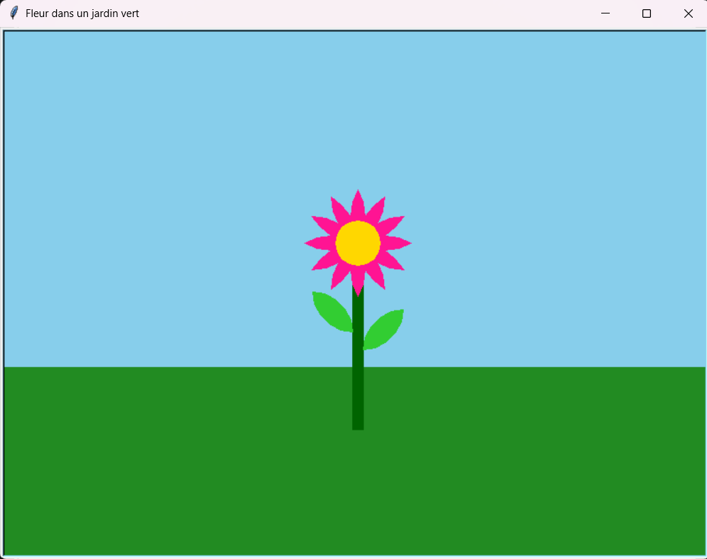

# 🌸 Fleur dans un jardin vert (Python Turtle)

Un petit projet graphique réalisé en **Python** à l'aide du module standard `turtle`. Ce script dessine une fleur rose à 12 pétales avec sa tige et ses feuilles, posée sur une pelouse verte sous un ciel bleu clair.

## Aperçu du résultat




## Fonctionnalités

* **Arrière-plan :** Ciel bleu clair (`#87CEEB`) et herbe verte (`#228B22`) sur une fenêtre de 800x600 pixels.
* **Tige et feuilles :** Une tige vert foncé accompagnée de deux feuilles symétriques dessinées à l'aide d'arcs de cercle.
* **Fleur :** 12 pétales rose vif (`#FF1493`) répartis à 360° autour d'un cœur jaune or (`#FFD700`).

## Prérequis

Ce projet utilise uniquement la bibliothèque intégrée `turtle`. Aucune installation de paquet externe n'est requise.

* **Python 3.x** installé sur votre machine.
* Support de **Tkinter** (inclus par défaut dans la plupart des installations Python sous Windows et macOS).

## Installation et exécution

1. **Cloner ou télécharger le projet :**
   ```bash
   git clone https://github.com/NF-Code9/fleur-turtle.git
   cd fleur-turtle
   ```

2. **Lancer le script :**
   ```bash
   python fleur_jardin.py
   ```
   *(Sur macOS ou Linux, utilisez `python3 fleur.py` si nécessaire).*

## Structure du projet

```text
├── fleur_jardin.py        # Code source principal du dessin
├── apercu.png      # Capture d'écran du rendu final
└── README.md       # Documentation du projet
```